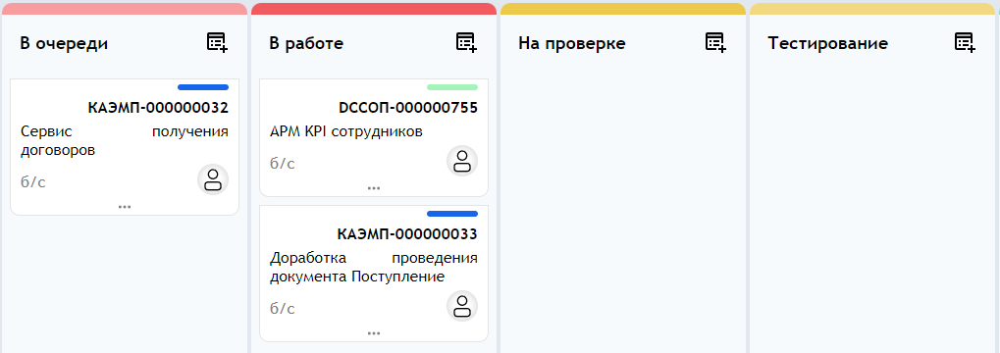

# Kanban Board (Канбан доска) для 1С:Предприятие

Лёгкая Kanban-доска для визуального управления задачами внутри среды «1С:Предприятие». Проект представляет собой HTML/JavaScript-компонент, который отображает задачи в виде колонок и карточек и получает данные в формате JSON.

## Возможности

- Отображение задач в виде Kanban-колонок.
- Карточки задач с кодом, названием, сроком и исполнителем.
- Цветовая индикация срока, проекта.
- Фильтрация по исполнителю.
- Перетаскивание карточек между колонками (Drag & Drop).
- Работа с данными в формате JSON.
- Без тяжёлых JS-фреймворков.

## Скриншоты



## Требования

- «1С:Предприятие» **8.3.27** и выше.
- Режим клиента: тонкий или веб-клиент.
- Права пользователя: чтение справочника задач и доступ к форме с HTML-полем.

## Использование

1. Откройте Kanban-доску.
2. Задачи отображаются в колонках по статусам.
3. Для фильтрации выберите исполнителя. Список исполнителей берётся из `executors`, текущий исполнитель — из `currentExecutor`.
4. Перетащите карточку в другую колонку, чтобы изменить статус задачи.
5. Изменения сохраняются через скрытую кнопку `interactionButton` (см. ниже).

### Сохранение изменений (механизм `interactionButton`)

При выполнении определённых действий в интерфейсе доски (например, после перетаскивания карточки) JavaScript вызывает метод `interactionButton.click()`. Это событие передаётся в модуль формы 1С и обрабатывается в обработчике `ПриНажатии` для поля HTML.

**Схема работы:**

```
Действие пользователя → JS вызывает interactionButton.click() → Событие «ПриНажатии» в 1С → Обработка и сохранение данных
```

Этот механизм позволяет безопасно передавать управление из JavaScript в код 1С без прямого доступа к данным.

## Формат данных

Доска получает JSON с колонками, задачами, списком исполнителей и названием проекта. Краткий пример:

```json
{
  "columns": [
    {
      "position": 3,
      "id": "awaiting",
      "title": "В очереди",
      "tasks": [
        {
          "id": "1128dddd-fb6f-11f0-a29b-7c10c9479bb6",
          "ref": "e1cib/data/Справочник.нЗадачи?ref=a29b7c10c9479bb611f0fb6f1128dddd",
          "code": "СООБУ-000000003",
          "name": "Задача №1",
          "deadline": "б/с",
          "deadlineColor": "#808080",
          "deadlineTitle": "срок выполнения",
          "avatarExecutor": "data:image/png;base64,...",
          "nameExecutor": "Гагарин Юрий",
          "altTextExecutor": "Гагарин Юрий",
          "sprintColor": "#ffffff",
          "projectColor": "#f670c1"
        }
      ]
    }
  ],
  "executors": [
    { "name": "Гагарин Юрий" },
    { "name": "Курчатов Игорь" }
  ],
  "currentExecutor": "Курчатов Игорь",
  "projectName": "Обучение (Собственная организация)"
}
```

## Архитектура

- `src/index.html` — точка входа, разметка контейнера доски и скрытая кнопка `interactionButton`.
- `src/script.js` — рендеринг колонок и карточек, обработка событий, вызов `interactionButton.click()`.
- `src/style.css` — стили интерфейса и адаптивная вёрстка.

## Ограничения

- `deadline` — отображаемая строка, а не дата в ISO-формате.
- Нет встроенной истории изменений или комментариев к задачам.
- Требуется доработка под конкретную конфигурацию 1С для обработки события `ПриНажатии`.

## Лицензия

Проект распространяется под лицензией **MIT**. См. файл [LICENSE](LICENSE).

## Автор

Perfilov Dmitry  
GitHub: [@perfilov131](https://github.com/perfilov131)
